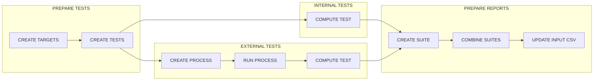

[](https://doi.org/10.5281/zenodo.XXXXXXX)

[](https://www.nextflow.io/)
[](https://docs.conda.io/en/latest/)
[](https://www.docker.com/)
[](https://sylabs.io/docs/)
[](https://tower.nf/launch?pipeline=https://github.com/Sage-Bionetworks-Workflows/nf-dcqc)

## Introduction

**Sage-Bionetworks-Workflows/nf-dcqc** is a Nextflow pipeline for Data Coordination Quality Control (DCQC). It downloads files from Synapse (imaging, sequencing and tabular data) and runs QC checks on them. It then writes the results of the checks to a copy of the input CSV.

The pipeline is built using [Nextflow](https://www.nextflow.io) DSL2. All QC logic is in the [`py-dcqc`](https://github.com/sage-bionetworks-workflows/py-dcqc) container. This pipeline only runs the `dcqc` command-line tool from that container. All `dcqc` steps use one shared `py-dcqc` container. Each external test runs in the container that `py-dcqc` specifies for that test.

Continuous integration (`.github/workflows/ci.yml`) runs the small `test` profile and the nf-test help-flag tests on pull requests and on published releases. The larger `test_full` profile is not run in CI.

## Pipeline summary

1. Prepare Tests
   - Create targets (`dcqc create-targets`) - Generates target specifications from input CSV
   - Create tests (`dcqc create-tests`) - Creates test specifications for each target
1. Run Internal Tests
   - Compute test results (`dcqc compute-test`) - Runs internal tests that don't require external processes
1. Run External Tests
   - Create process (`dcqc create-process`) - Generates process specifications for external tests
   - Run process - Executes external processes
   - Compute test results (`dcqc compute-test`) - Evaluates results from external processes
1. Prepare Reports
   - Create test suites (`dcqc create-suite`) - Groups test results by target
   - Combine test suites (`dcqc combine-suites`) - Aggregates results across all test suites
   - Update input CSV (`dcqc update-csv`) - Updates the original input CSV with test results

## Pipeline Flow



## Quick Start

1. Install [`Nextflow`](https://www.nextflow.io/docs/latest/getstarted.html#installation) (`>=25.10.0`)

   > The pipeline sets a minimum Nextflow version only, with no upper bound (see `manifest.nextflowVersion` in `nextflow.config`). The code works with the strict config parser, which is the default from Nextflow 26.04.0. CI (`.github/workflows/ci.yml`) runs the test profile and the nf-test tests on the minimum version, on 26.04.0 (the version that Sage's Seqera Platform uses) and on `latest-everything`. The minimum is 25.10.0 because the `nf-schema` 2.7.2 plugin needs it.

2. Install any of [`Docker`](https://docs.docker.com/engine/installation/), [`Singularity`](https://www.sylabs.io/guides/3.0/user-guide/) (you can follow [this tutorial](https://singularity-tutorial.github.io/01-installation/)), [`Podman`](https://podman.io/), [`Shifter`](https://nersc.gitlab.io/development/shifter/how-to-use/) or [`Charliecloud`](https://hpc.github.io/charliecloud/). The pipeline needs a container engine: the `dcqc` steps have no Conda environment.

3. Add your Synapse token as a nextflow secret

   ```bash
   nextflow secrets set SYNAPSE_AUTH_TOKEN <token>
   ```

4. Download the pipeline and test it on a minimal dataset with a single command:

   ```bash
   nextflow run Sage-Bionetworks-Workflows/nf-dcqc -profile test,YOURPROFILE --outdir <OUTDIR>
   ```

   Note that some form of configuration will be needed so that Nextflow knows how to fetch the required software. This is usually done in the form of a config profile (`YOURPROFILE` in the example command above). You can chain multiple config profiles in a comma-separated string.

   > - The pipeline comes with config profiles called `docker`, `singularity`, `podman`, `shifter` and `charliecloud` which instruct the pipeline to use the named tool for software management. For example, `-profile test,docker`. The `conda` and `mamba` profiles are left from the nf-core template. Do not use them: the `dcqc` processes have no Conda environment and need a container.
   > - By default, the pipeline does not download the nf-core institutional configs, so a network problem cannot stop the run at startup. To use an institutional profile from [nf-core/configs](https://github.com/nf-core/configs#documentation), set `--custom_config_base https://raw.githubusercontent.com/nf-core/configs/<version>` (use a tag or commit, not `master`) and then use `-profile <institute>`. If this download fails, the run stops before any task starts.
   > - If you are using `singularity`, please use the [`nf-core download`](https://nf-co.re/tools/#downloading-pipelines-for-offline-use) command to download images first, before running the pipeline. Setting the [`NXF_SINGULARITY_CACHEDIR` or `singularity.cacheDir`](https://www.nextflow.io/docs/latest/singularity.html?#singularity-docker-hub) Nextflow options enables you to store and re-use the images from a central location for future pipeline runs.
   > - If you are using `conda`, it is highly recommended to use the [`NXF_CONDA_CACHEDIR` or `conda.cacheDir`](https://www.nextflow.io/docs/latest/conda.html) settings to store the environments in a central location for future pipeline runs.

5. Start running your own analysis!

   ```bash
   nextflow run Sage-Bionetworks-Workflows/nf-dcqc --input samplesheet.csv --outdir <OUTDIR> -profile <docker/singularity/podman/shifter/charliecloud/institute>
   ```

## Input

The `--input` file is a CSV file with these columns:

| Column         | Required | Description                                                                                                      |
| -------------- | -------- | ---------------------------------------------------------------------------------------------------------------- |
| `url`          | Yes      | A Synapse URI, for example `syn://syn41864974`.                                                                  |
| `file_type`    | No       | The file type, for example `TXT`, `TIFF`, `OME-TIFF`, `HDF5`, `TSV`, `CSV`, `JSON`, `JSON-LD`, `BAM` or `FASTQ`. |
| `md5_checksum` | No       | The expected MD5 checksum of the file.                                                                           |

The file can have more columns (for example `test`). See `testdata/input_txt.csv` and `testdata/input_full.csv` for examples. At startup, `nf-schema` does a basic check of the file against `assets/schema_input.json`. The `dcqc create-targets` step does the full check of each row.

Use these optional parameters to control which tests decide if a file passes:

- `--required_tests`: a comma-separated list of test names that must pass, for example `LibTiffInfoTest,BioFormatsInfoTest`.
- `--skipped_tests`: a comma-separated list of test names to skip.

Run `nextflow run Sage-Bionetworks-Workflows/nf-dcqc --help` to see all parameters.

## Output

The pipeline writes these files to `--outdir`:

- `output.csv`: the input CSV, with the QC results added.
- `suites.json`: the combined test suites for all files.
- `pipeline_info/`: the Nextflow execution report, timeline, trace and DAG.

## Special Considerations for Running `nf-dcqc` on Nextflow Tower

`nf-dcqc` leverages the reports feature when executed on Tower. This is done by pointing Tower to the generated `output.csv` file which is saved to `params.outdir` after a successful run. By default, the `outdir` for the workflow is set to a local directory called `results`. This does not work on Nextflow Tower runs, as you will not have access to the `results` directory once the job has completed. Thus, the `outdir` should be set to an S3 bucket location that the Tower workspace you are using has access to. For example, in the `pipeline parameters` for a Tower run, you can provide YAML such as:

```yaml
outdir: s3://example-project-tower-bucket/dcqc_output
```

From the reports tab within your workflow run, you can view and download the generated `output.csv` file.

## `py-dcqc` Image

This pipeline's own version is tracked in `manifest.version` (`nextflow.config`) and `CHANGELOG.md`, following the [Keep a Changelog](https://keepachangelog.com/en/1.0.0/) / semver convention inherited from the nf-core template. Publishing a GitHub Release runs the same CI job (`-profile test,docker`) defined in `.github/workflows/ci.yml`.

All QC logic itself lives in a separate container, [`ghcr.io/sage-bionetworks-workflows/py-dcqc`](https://github.com/sage-bionetworks-workflows/py-dcqc), which is versioned and released independently of this pipeline. This repo pins that container to a specific tag in the `withLabel:dcqc` block of `conf/base.config`, rather than tracking `:latest`, so that pipeline runs stay reproducible over time and don't silently pick up breaking changes from py-dcqc.

To pick up a new `py-dcqc` release, update the tag in `conf/base.config` only (there is no other place that sets this container), then re-run the `test`/`test_full` profile before merging, since py-dcqc's CLI contract can change between versions.

## Credits

Sage-Bionetworks-Workflows/nf-dcqc (sage/dcqc) was originally written by Bruno Grande.

<!-- TODO nf-core: If applicable, make list of people who have also contributed -->

## Contributions and Support

If you would like to contribute to this pipeline, please see the [contributing guidelines](.github/CONTRIBUTING.md).

## Citations

<!-- TODO nf-core: Add citation for pipeline after first release. Uncomment lines below and update Zenodo doi and badge at the top of this file. -->
<!-- If you use  Sage-Bionetworks-Workflows/nf-dcqc for your analysis, please cite it using the following doi: [10.5281/zenodo.XXXXXX](https://doi.org/10.5281/zenodo.XXXXXX) -->

<!-- TODO nf-core: Add bibliography of tools and data used in your pipeline -->

An extensive list of references for the tools used by the pipeline can be found in the [`CITATIONS.md`](CITATIONS.md) file.

This pipeline uses code and infrastructure developed and maintained by the [nf-core](https://nf-co.re) community, reused here under the [MIT license](https://github.com/nf-core/tools/blob/master/LICENSE).

> **The nf-core framework for community-curated bioinformatics pipelines.**
>
> Philip Ewels, Alexander Peltzer, Sven Fillinger, Harshil Patel, Johannes Alneberg, Andreas Wilm, Maxime Ulysse Garcia, Paolo Di Tommaso & Sven Nahnsen.
>
> _Nat Biotechnol._ 2020 Feb 13. doi: [10.1038/s41587-020-0439-x](https://dx.doi.org/10.1038/s41587-020-0439-x).
